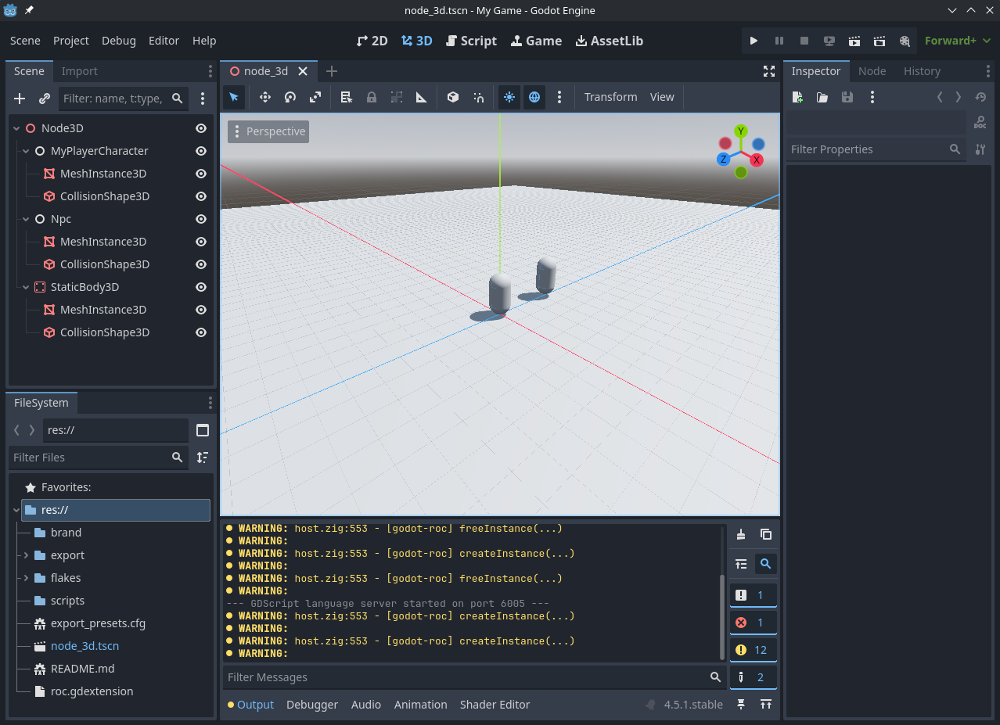

# SurvivePG

An action-RPG, where you automatically attack nearby mobs. It plays like a traditional proceedurally generated ARPG, with stats, gear & abilities. But the attacks are mostly auto.



Built with [godot-roc](https://).

## Build Requirements

> [!TIP]
> Learn about [Blueprint](https://github.com/lukewilliamboswell/roc-blueprint) & [Nix Flakes](https://nixos.wiki/wiki/Flakes).

* `godot4.5` or newer; `redot26.2`, `godot4.7`, `godot4.5`, `rex0.0` etc.
* `roc` [Install](https://roc-lang.org/install)
* `linux-x86_64` & web `wasm32-emscripten` only (Windows, MacOS & Web support coming soon)

## Build & Run

```sh
# Enter reproducable dev environment:
# nix run github:lukewilliamboswell/roc-blueprint/0.5.0 -- shell
blueprint shell

# Run [baseline] godot
godot4.5 project.godot

# Run redot
#redot project.godot

# Run godot
#godot project.godot

# [Linux] Build
roc build main.roc --target=x64musl --output=my_game.so

# [Windows] Build
# roc build main.roc --target=x64mingw --output=my_game.dll
 
# [Mac] Build
# roc build main.roc --target=x64mac --output=my_game.dylib

# Important:
# Output needs to match roc.gdextension [libraries] section.
#
# Note:
# Godot should be able to hotreload the changes, see:
# template/godot/roc.gdextension -> reloadable = true
# Godot only reloads when the godot window is focused.
# We're investigating ways to make this workflow even better.
```

## Publish for web

```sh
# Enter reproducable publish to web environment:
# nix run github:lukewilliamboswell/roc-blueprint/0.5.0 -- shell
blueprint shell publish-to-web-env

# [Web] Build
roc build main.roc --target=wasm32 --output=my_game.wasm

# Web publish (requires Godot web export templates to be installed.)
# /home/{user}/.local/share/godot/export_templates/4.5.1.stable/web_dlink_nothreads_release.zip
godot4.5 --export-release Web export/

# Convert `wasm32-standalone` to `wasm32-emscripten` SIDE_MODULE=2
emcc ...

# Web serve
SERVE_PATH=export/ roc scripts/serve.roc

# Open in browser...
open http://localhost:8000/index.html
```

## Resources

* **Roc** - [[Homepage](https://roc-lang.org/)] [[docs](#)] [[source](#)]
* **Godot Engine** - [[Homepage](https://godotengine.org/)] [[docs](#)] [[source](#)]
* **Redot Engine** - [[Homepage](https://www.redotengine.org/)] [[docs](#)] [[source](#)]
* **Draconic Engine** - [[Homepage](https://github.com/Redot-Engine/DraconicEngine)] [[docs](#)] [[source](#)]

## Troubleshoot

```sh
# Verify: roc.gdextension
cat roc.gdextension
# Ensure the built your game's dynamic library exists for the target platform & architecture:
#   .so for linux
#   .dll for windows
#   .dylib for macos
#   .wasm for web
# Ensure the library filepath is correct.
# Ensure the entry_symbol is correct.
# Ensure godot's stdout is not printing any errors, if so read them carefully.
```

## Upgrade Platform

1) Make a backup of your game & tools.
2) Update your game engine to your preferred version of choice; `godot`, `redot`, `rex`. And ensure compatability.
3) Update your `roc` compiler to your preferred version of choice. And ensure compatibility.
4) Goto `godot-roc` releases page.
5) Find the version you want.
6) Edit `main.roc` and update the `platform` url, to either; the online version (easy) or you can download and "vendor" the precompiled (offline is safer & more robust) or source code (customizable) versions locally.
7) Compile & run your game from a CommandLine Interface (cli); godot-roc will print engine compatability information, and give you engine & version mismatch warnings. There may be breaking API changes, in which case it should just be a matter of fixing compiler errors & warnings. Godot seems to be pretty good with backwards compatibility, so this will mostly be the case when downgrading or switching engines.
